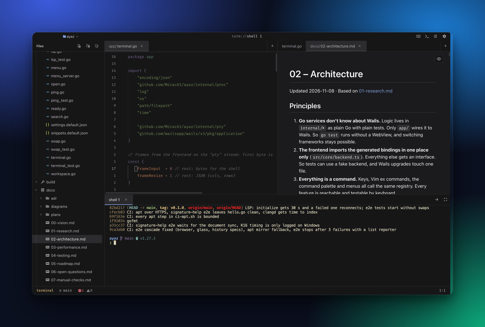

# Ayaz

A keyboard-first code editor with a Neovim feel. It shows Markdown, PDFs and images properly and has a real terminal built in. Built with [Wails v3](https://v3.wails.io) (Go) and CodeMirror 6 (TypeScript), for macOS, Linux and Windows.

[](https://github.com/Mirac61/ayaz/actions/workflows/ci.yml)
[](https://github.com/Mirac61/ayaz/actions/workflows/release.yml)
[](https://github.com/Mirac61/ayaz/releases/latest)
[](https://v3.wails.io)
[](#install)



## Contents

- [Features](#features)
- [Install](#install)
- [Use](#use)
- [Configuration files](#configuration-files)
- [Develop](#develop)
- [Contributing](#contributing)
- [Docs](#docs)
- [Status and license](#status-and-license)

## Features

- **Vim, not an imitation of it:** motions, text objects (also structural ones: functions, arguments), operators, `.`, registers, macros, visual and block mode, `:` commands, surround.
- **Language servers** for Go, C/C++, TypeScript/JavaScript, HTML/CSS/JSON and Java: diagnostics, completion, hover, go to definition, rename, code actions, semantic colours, call hierarchy.
- **Debugging** Go programs with Delve (breakpoints, stepping, variables).
- **Markdown** that renders while you type, a reading view, and a side-by-side preview. A button at the top right of a Markdown or SVG pane switches between rendered view and source.
- **PDF and images** (PNG, JPG, GIF, WebP, SVG) in the same panes as text.
- **A real terminal** (xterm.js on a PTY): TUI programs such as `htop`, `lazygit` and `nvim` work.
- **Git** in the editor: gutter marks, status in the tree, diff against HEAD, inline blame, stage and reset hunks, merge-conflict helpers.
- **Project search and replace**, fuzzy file finder, command palette, quickfix list, project tasks.
- **One folder per window**, session and unsaved changes restored per folder, local file history.
- **Colour swatches** before hex colours; click one to pick a new colour.
- Everything is a command and has a key. Bindings, settings and snippets are plain JSON files you edit in the app.

## Install

### Download a release

Every `v*` tag builds the three archives below ([latest release](https://github.com/Mirac61/ayaz/releases/latest)):

| File | Platform | What's inside | How to start it |
|---|---|---|---|
| `ayaz-windows-amd64.zip` | Windows 10/11, x64 | `ayaz.exe` | Unzip anywhere and run `ayaz.exe`. SmartScreen warns because the exe isn't signed: *More info → Run anyway*. Needs WebView2 (part of Windows 11, on Windows 10 usually installed with Edge). |
| `ayaz-macos-arm64.zip` | macOS, Apple silicon | `ayaz.app` | Unzip, move to `/Applications`. The app isn't notarized: right-click → Open on the first start, or `xattr -dr com.apple.quarantine /Applications/ayaz.app`. |
| `ayaz-linux-amd64.tar.gz` | Linux, x64 | `ayaz` binary, `ayaz.desktop` | Put `ayaz` on your `PATH`, the desktop file in `~/.local/share/applications`. Needs `gtk4` and `webkitgtk-6.0`. |

### Build from source

Each platform needs **Go**, **[Bun](https://bun.sh)**, **[Task](https://taskfile.dev)** and the Wails CLI:

```sh
go install github.com/wailsapp/wails/v3/cmd/wails3@v3.1.0
git clone https://github.com/Mirac61/ayaz && cd ayaz
task install
```

`task install` builds the app and installs it for the current user:

| Platform | What it does | Extra requirements |
|---|---|---|
| macOS | builds `bin/ayaz.app`, copies it to `/Applications/Ayaz.app` | Xcode Command Line Tools |
| Linux | binary to `~/.local/bin/ayaz`, launcher entry to `~/.local/share/applications` | `gtk4`, `webkitgtk-6.0` and their `-dev` packages |
| Windows | `ayaz.exe` to `%LOCALAPPDATA%\Ayaz` and a Start menu shortcut | WebView2 (part of Windows 11) |

Arch Linux can use the package instead: `cd build/linux/arch && makepkg -si`.

### Language servers (optional)

Ayaz starts them through your login shell (on Windows: from `PATH`), so whatever you have installed works. A missing server shows a hint in the status line.

| Language | Server |
|---|---|
| Go | `go install golang.org/x/tools/gopls@latest` (debugging: `dlv`) |
| C/C++ | `clangd` (Xcode Command Line Tools, or `clang` on Arch); a `compile_commands.json` gives it the real flags |
| TS/JS | `bun add -g typescript typescript-language-server` |
| HTML/CSS/JSON | `bun add -g vscode-langservers-extracted` |
| Java | `jdtls` (Homebrew or AUR) |

## Use

```sh
ayaz ~/code/project        # open a folder (macOS: /Applications/Ayaz.app/Contents/MacOS/ayaz)
ayaz main.go:12            # with Ayaz running: open the file at that line in the window of its folder
EDITOR="ayaz --wait" git commit   # git waits until the buffer is closed
```

The leader key is `Space`. A few bindings to start with:

| Keys | Does |
|---|---|
| `<Space>ff` / `fw` / `fk` | find files / search text / command palette |
| `<Space>e` | focus the file tree |
| `<Space>t` | terminal panel |
| `<Space>mr` / `mp` | Markdown reading view / preview split |
| `<Space>cr` / `ca` | rename / code action |
| `<Space>gb` / `gd` / `gg` | blame / diff / lazygit |
| `<Space>dd` / `db` / `dc` | start debugging / breakpoint / continue |
| `<C-w>v` / `s` | split right / down |

The welcome page lists more. Everything is a command ID: `<Space>fk` shows them all, and the keymap file rebinds any of them.

## Configuration files

Ayaz creates three JSON files on the first start, each with comments that explain the format. `Cmd+,` (Linux and Windows: `Ctrl+,`) opens them in a settings window; a saved file applies without a restart.

| File | What it controls | Defaults, explained |
|---|---|---|
| `settings.json` | font and size, theme and colours, tab width, wrapping, format on save, sidebar and status line, project tasks, per-language overrides | [`app/settings.default.json`](app/settings.default.json) |
| `keymap.json` | extra or changed key bindings, by mode and command ID | [`app/keymap.default.json`](app/keymap.default.json) |
| `snippets.json` | your own snippets per language | [`app/snippets.default.json`](app/snippets.default.json) |

They live in `~/Library/Application Support/ayaz` (macOS), `~/.config/ayaz` (Linux) or `%AppData%\ayaz` (Windows).

## Develop

```sh
wails3 dev                        # hot reload
task build                        # binary in bin/
go test ./...                     # Go tests
cd frontend
bun install
bun run typecheck && bun run lint
bun run test                      # unit tests (Vitest, Node)
bun run test:browser              # component tests (Vitest browser mode, WebKit)
bun run e2e                       # Playwright against the server build (see docs/04-testing.md)
```

| Workflow | Runs on | What it does |
|---|---|---|
| [`ci.yml`](.github/workflows/ci.yml) | every push | Go vet and tests on macOS and Linux, a Windows cross-build, the frontend checks, browser and E2E tests |
| [`release.yml`](.github/workflows/release.yml) | `v*` tags, manual | builds the macOS, Windows and Linux archives; a tag also publishes them as a GitHub release |

The code is split like this:

| Folder | Contents |
|---|---|
| `app/` | Wails services: workspace, terminal, language servers, debugger, settings |
| `internal/` | Go packages: `workspace` (path jail, file ops), `lsp`, `dap`, `pty`, `proc`, `git`, `search`, `index`, `watch`, `fsserve` |
| `frontend/src/` | `editor/` (CodeMirror, Vim, Markdown), `shell/` (panes, tree, picker), `viewers/` (images, PDF, browser), `terminal/`, `debug/`, `core/`, `theme/` |
| `build/` | per-platform packaging (`darwin`, `linux`, `windows`) |
| `docs/` | vision, research, architecture, ADRs, roadmap, test strategy |

## Contributing

Bug reports and ideas go into [issues](https://github.com/Mirac61/ayaz/issues). For a pull request, keep it to one change, add a test next to the code you touch, and run the checks from [Develop](#develop) before pushing; CI runs the same on macOS and Linux. Reports from Windows are especially welcome: [docs/08-windows.md](docs/08-windows.md) lists what to check first.

## Docs

[Vision](docs/00-vision.md) · [Architecture](docs/02-architecture.md) · [Performance](docs/03-performance.md) · [Testing](docs/04-testing.md) · [Roadmap](docs/05-roadmap.md) · [Manual checks](docs/07-manual-checks.md) · [Windows](docs/08-windows.md) · [Decisions (ADRs)](docs/adr/)

## Status and license

Daily-usable on macOS and Arch Linux/Hyprland. Windows builds come with every release but haven't been tested much on real machines yet.

Copyright © 2026 Mirac. All rights reserved.

Ayaz is free to download, build from source, and use for personal and professional software development. However, the software and source code are proprietary: **forking, modifying, copying, or redistributing the software or its code is strictly prohibited** without prior written permission. See [LICENSE](LICENSE) for details.
