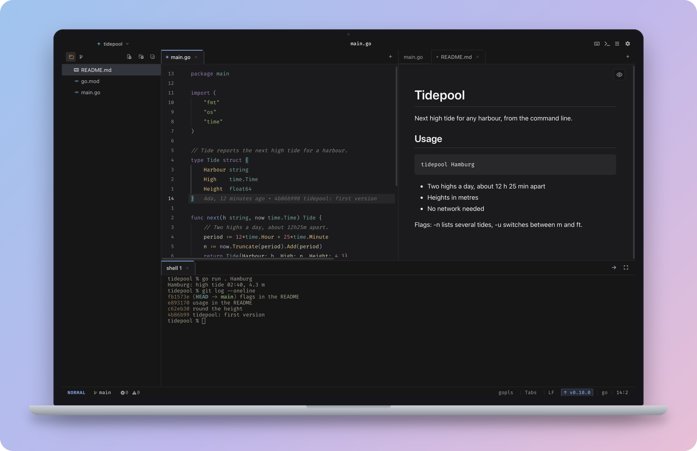

# Ayaz

[](https://github.com/Mirac61/ayaz/actions/workflows/ci.yml)
[](https://github.com/Mirac61/ayaz/releases/latest)

A code editor that feels like Neovim, but shows Markdown, PDFs and images properly and has a real terminal built in. Written in Go ([Wails v3](https://v3.wails.io)) and TypeScript ([CodeMirror 6](https://codemirror.net)), for macOS, Linux and Windows.



I built it because the editors I use each miss one thing. VSCodium is heavy. Neovim can't show a PDF or an image, and has no Markdown that renders while you type. Obsidian wants a vault and isn't a code editor. Ayaz opens any folder, keeps your hands on the keyboard, and keeps its own state (session, history, unsaved changes) outside your project.

Daily-driven on macOS and Arch Linux/Hyprland. Windows builds ship with every release but are barely tested. Free to download and use; the source is closed to forks and redistribution, see [License](#license).

## Install

Grab the archive for your system from the [latest release](https://github.com/Mirac61/ayaz/releases/latest) (checksums in `SHA256SUMS`):

| File | Platform | First start |
|---|---|---|
| `ayaz-macos-arm64.zip` | macOS, Apple silicon | Move `ayaz.app` to `/Applications`. It isn't notarized: right-click → Open once, or `xattr -dr com.apple.quarantine /Applications/ayaz.app`. |
| `ayaz-linux-amd64.tar.gz` | Linux, x64 | Put `ayaz` on your `PATH` and `ayaz.desktop` in `~/.local/share/applications`. Needs `gtk4` and `webkitgtk-6.0`. |
| `ayaz-windows-amd64.zip` | Windows 10/11, x64 | Unzip and run `ayaz.exe`. SmartScreen warns about the unsigned exe: *More info → Run anyway*. Needs WebView2. |

Building from source requires Go, Bun, Task and the Wails CLI; then `task install` does the rest. Details, plus the language servers to install, are in [docs/building.md](docs/building.md).

## Use

```sh
ayaz ~/code/project               # open a folder
ayaz main.go:12                   # jump to a line in the running window of that folder
EDITOR="ayaz --wait" git commit   # git waits until you close the buffer
```

The leader key is `Space`. Everything is a command with an ID, and `<Space>fk` lists them all.

| Keys | Does |
|---|---|
| `<Space>ff` / `fw` / `fk` | find files / search text / command palette |
| `<Space>e` / `t` | file tree / terminal panel |
| `<Space>mr` / `mp` | Markdown reading view / preview split |
| `<Space>cr` / `ca` | rename / code action |
| `<Space>gb` / `gd` / `gg` | blame / diff / lazygit |
| `<Space>dd` / `db` / `dc` | start debugging / breakpoint / continue |
| `<C-w>v` / `s` | split right / down |

## Features

| Area | What you get |
|---|---|
| Vim | An emulation, not Neovim: [`@replit/codemirror-vim`](https://github.com/replit/codemirror-vim) plus Ayaz's own extensions. Supported: motions, text objects (also structural ones such as functions and arguments), operators, `.`, registers, macros, visual and block mode, `:` commands, surround. Not supported: Vimscript, Lua config, plugins, and 100 % compatibility with Vim |
| Languages | language servers for Go, C/C++, TypeScript/JavaScript, HTML/CSS/JSON, Java, Python, Rust, Lua, YAML, TOML, Dockerfile, LaTeX and Typst: diagnostics, completion, hover, go to definition, rename, code actions, semantic colours, call hierarchy. A missing server shows an install hint instead of failing |
| Debugging | Go (Delve), Python (debugpy), C, C++ and Rust (lldb-dap): breakpoints, stepping, variables |
| Documents | Markdown renders while you type, with a reading view and a side-by-side preview. PDFs and images (PNG, JPG, GIF, WebP, SVG) open in the same panes as text |
| Terminal | a real PTY (xterm.js), so `htop`, `lazygit` and `nvim` work; `file:line:col` in the output opens the file |
| Git | gutter marks, status in the tree, diff against HEAD, inline blame, stage and reset hunks, merge-conflict helpers |
| Navigation | project search and replace, fuzzy file finder, command palette, quickfix list, project tasks |
| Folders | one per window, session and unsaved changes restored, local file history, a start page with your recent folders. Updates come from the GitHub releases |

## Configure

Three JSON files, created on first start with comments that explain the format. `Cmd+,` (Linux and Windows: `Ctrl+,`) opens them in a settings window; a saved file applies without a restart.

| File | Controls | Defaults |
|---|---|---|
| `settings.json` | font, theme and colours, tab width, wrapping, format on save, sidebar, project tasks, per-language overrides | [`settings.default.json`](app/settings.default.json) |
| `keymap.json` | key bindings by mode and command ID | [`keymap.default.json`](app/keymap.default.json) |
| `snippets.json` | your own snippets per language | [`snippets.default.json`](app/snippets.default.json) |

They live in `~/Library/Application Support/ayaz` (macOS), `~/.config/ayaz` (Linux) or `%AppData%\ayaz` (Windows).

## Develop

```sh
wails3 dev                            # hot reload
task test                             # Go, typecheck and Node tests
bun run --cwd frontend test:browser   # browser tests (WebKit), not run in CI
bun run --cwd frontend e2e            # Playwright against the server build, not run in CI
```

The code is split into Wails services in `app/`, Go packages in `internal/` and the React and CodeMirror frontend in `frontend/src/`. Where to read on:

| Read | For |
|---|---|
| [Architecture](docs/02-architecture.md) | how the Go services, the frontend and Wails fit together, with diagrams |
| [Testing](docs/04-testing.md) | what runs where, and what you have to run yourself |
| [Decisions](docs/adr/) | one short record per big choice: Wails, CodeMirror, the terminal, search and more |
| [Building](docs/building.md) | building from source, installing the language servers and debug adapters |
| [Vision](docs/00-vision.md) | why Ayaz exists and what it leaves out on purpose |
| [Performance](docs/03-performance.md) | the budgets and how they are measured |
| [Roadmap](docs/05-roadmap.md) | every milestone and what is still open |
| [Manual checks](docs/07-manual-checks.md) and [Windows](docs/08-windows.md) | what no automated test reaches |

## Contributing

Bug reports and ideas go into [issues](https://github.com/Mirac61/ayaz/issues). A pull request should be one change with a test next to the code it touches; run the checks from [Develop](#develop) first, since CI only covers the Go and Node ones. Reports from Windows are especially welcome: [docs/08-windows.md](docs/08-windows.md) lists what to check first.

## License

Copyright © 2026 Mirac. All rights reserved. Ayaz is free to download, build from source and use for personal and professional software development. The software and its source code are proprietary: forking, modifying, copying or redistributing them is prohibited without prior written permission. See [LICENSE](LICENSE).
