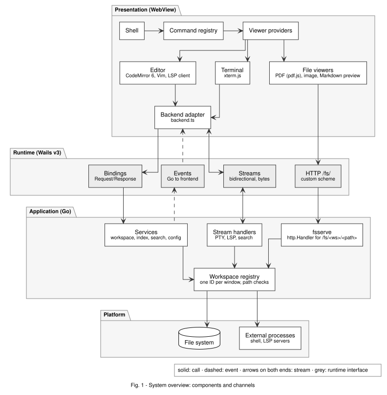
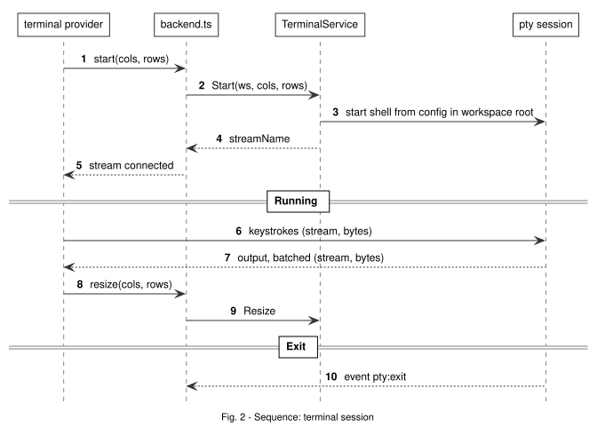
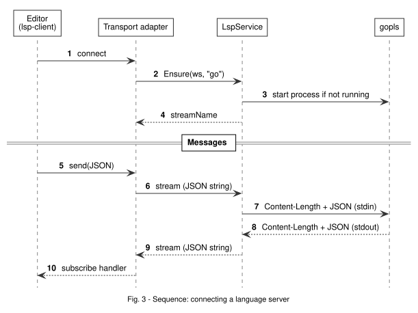
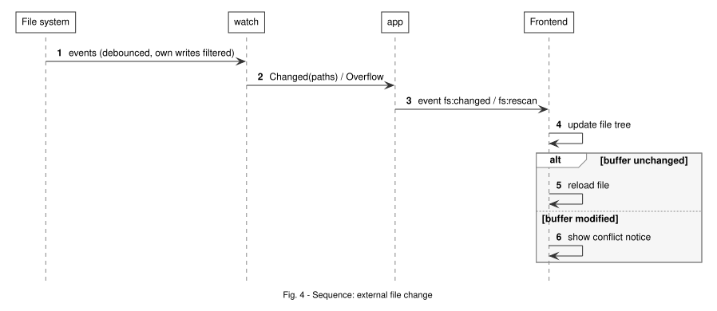
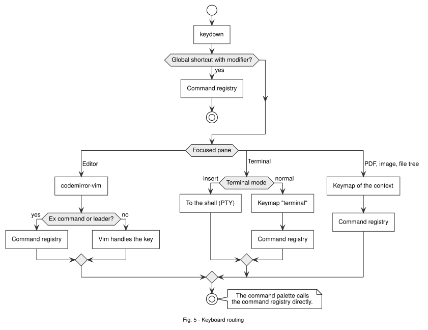

# 02 – Architecture

Updated 2026-11-08 · Based on [01-research.md](01-research.md)

## Principles

1. **Go services don't know about Wails.** Logic lives in `internal/*` as plain Go with plain tests. Only `app/` wires it to Wails. So `go test` runs without a WebView, and switching frameworks stays possible.
2. **The frontend imports the generated bindings in one place only** (`src/core/backend.ts`). Everything else gets an interface. So tests can use a fake backend, and Wails upgrades touch one file.
3. **Everything is a command.** Keys, Vim ex commands, the command palette and menus all call the same registry. Every feature is reachable and testable by keyboard.
4. **Everything in a pane is a provider.** Editor, terminal, PDF, image and Markdown preview share one interface.
5. **Imperative components stay out of React state.** CM6, xterm.js and pdf.js are mounted into a DOM element and manage themselves. React only renders the shell, so UI changes never re-render the editor or terminal.
6. **Validate at the trust boundary.** Go checks every path and workspace ID coming from the frontend.
7. **One workspace per window.** Everything tied to a folder (files, watcher, index, LSP, terminals) hangs off a workspace ID.

## Overview



## Folder layout (planned)

```
ayaz/
  main.go                 # only: build options, app.Run
  internal/
    workspace/            # root, path jail, read/write (atomic), listing, registry (ID → workspace)
    fsserve/              # http.Handler for /fs/<ws>/<path>
    watch/                # interface + fswatcher adapter, debounce, self-write filter
    index/                # file index + fuzzy matcher
    search/               # project search and replace
    pty/                  # terminal sessions: start shell, resize, batch output
    lsp/                  # server processes, Content-Length framing, restart
    config/               # settings + keymaps (JSON in os.UserConfigDir)
  app/                    # Wails services, streams, event bridge, windows
  frontend/               # Bun + Vite + React + TS
    src/
      core/               # commands, keymap, backend.ts, viewer registry, buffers, quickfix
      shell/              # layout, splits, optional tabs, tree, picker, palette, status line
      editor/             # CM6 setup, vim/, theme, lsp transport
      lang/               # extension → language package + LSP server
      mdlive/             # live preview extension
      terminal/           # xterm.js provider, theme, stream
      viewers/            # pdf/, image/, mdpreview/
      theme/              # Kanagawa tokens (CSS variables, CM6, xterm)
  docs/
  spikes/                 # throwaway code from Phase 0/M0
```

## Modules

### Go

| Module | Does | Depends on |
|---|---|---|
| `workspace` | Registry `ID → Workspace`. Per workspace: root, `Resolve(rel)` (jail), listing, read text (with mtime), atomic write (temp + fsync + rename), tear-down of everything that belongs to it | stdlib |
| `fsserve` | `GET/HEAD /fs/<ws>/<rel>` → `Resolve` → `http.ServeContent` | `workspace` |
| `watch` | watch recursively, debounce, filter own writes, overflow → rescan | fswatcher |
| `index` | file list (ignore rules), updated from `watch`, `Query(q, limit)` | `watch` |
| `search` | literal/regex over index files, parallel, streamed, replace via `workspace` | `index`, `workspace` |
| `pty` | start a shell session (from config, default `$SHELL -l`, cwd = root), I/O, resize, batch output, report exit | `creack/pty`, `config` |
| `lsp` | start/stop a server per (workspace, language), framing, restart with backoff, find servers via `PATH`/config | stdlib |
| `config` | settings, keymaps, language → server mapping, recent folders | stdlib |
| `app` | Wails services, stream handlers, event names, windows | Wails + all of the above |

### Frontend

| Module | Does |
|---|---|
| `core/commands` | `register(id, handler, meta)`, `run(id, args)`, list for the palette |
| `core/keymap` | key → command ID, per context (`editor`, `terminal`, `pdf`, `image`, `tree`, `picker`) |
| `core/backend.ts` | the only import of bindings/runtime; knows its workspace ID and adds it to every call |
| `core/viewers` | provider registry, picks a provider per file |
| `core/buffers` | buffer store (EditorState, path, mtime, dirty) |
| `core/quickfix` | one list for search hits, LSP references, later build errors; `:cn`/`:cp` |
| `shell` | layout, splits, optional tab bar, virtualized tree, picker, palette, status line |
| `editor` | CM6 per buffer, Vim, theme, LSP client per language |
| `lang` | table extension/filename → language package (lazy) + LSP server ID |
| `mdlive` | live preview extension |
| `terminal` | xterm.js provider, renderer choice, terminal normal mode |
| `viewers/*` | PDF, image, Markdown preview |

## Provider interface

Goal: new pane content without touching the shell. Kept small on purpose.

```ts
// core/viewers.ts – draft, not production code
export interface FileRef {
  path: string        // workspace-relative, with "/"
  ext: string         // lowercase, no dot
  size: number
}

export interface ViewContext {
  backend: Backend    // adapter with workspace ID, never the bindings directly
  commands: Commands
  fileUrl(path: string): string   // -> "/fs/<ws>/<encoded>"
}

export interface ViewHandle {
  title(): string                  // for tab bar / buffer list
  focus(): void
  dispose(): void
  onExternalChange?(): void        // watcher reported a change
  isDirty?(): boolean
  save?(): Promise<void>
  getViewState?(): unknown         // scroll position / zoom / cursor
  setViewState?(s: unknown): void
  keymapContext: string            // "editor" | "terminal" | "pdf" | ...
}

export interface ViewProvider {
  id: string                       // "editor", "terminal", "pdf", "image", "md-preview"
  canOpen(f: FileRef): number      // 0 = no, higher = preferred
  mount(el: HTMLElement, f: FileRef | null, ctx: ViewContext): Promise<ViewHandle>
}
```

Why it looks like this:
- `canOpen` returns a priority, so Markdown opens in the editor (10) and `md-preview` can show the same file in a second pane (5).
- `FileRef | null`: the terminal has no file but is still pane content.
- `mount` takes a DOM element, so providers don't depend on React.
- `keymapContext` tells the keymap which bindings apply in the focused pane.

### Splits, buffers, tabs

- Same model as Vim: **buffers** (open files and terminals) exist independently of **panes**. A pane shows one buffer.
- Splits are a tree of horizontal/vertical divisions (`:split`, `:vsplit`, `Ctrl-w h/j/k/l`).
- The optional tab bar shows the buffers recently shown in a pane. It's only a view, not a separate model, so turning it on or off is a setting, not a rebuild.
- **Bottom panel** (like VS Code/Zed): a pane below the split tree, toggled with `Cmd+J` / `Ctrl+Shift+J`. It shows a buffer like any other pane, usually a terminal. A terminal can also open as a normal pane in the splits (`:terminal`). Same buffer model, two places to show it (Q23).
- No persistent undo and no session restore in v1.

## Go ↔ frontend

Four channels, each for one job:

| Channel | Direction | Used for | Why |
|---|---|---|---|
| **Bindings** | FE → Go, request/response | open workspace, listing, read/write text, fuzzy query, config, start terminal/LSP | typed, generated TS |
| **Events** | Go → FE | `fs:changed`, `fs:rescan`, `index:ready`, `pty:exit`, `lsp:status` | small notifications |
| **Streams** | both ways, bytes | PTY I/O, LSP messages, search results | ordered, no port, built for streams |
| **HTTP `/fs/`** | FE → Go, bytes | PDFs, images, images in Markdown | Range, browser cache, no Base64 |

### Services (draft)

```go
// app/ – Wails service wrappers, draft
type WorkspaceService struct{ reg *workspace.Registry }

func (s *WorkspaceService) Open(root string) (Info, error)           // returns WorkspaceID
func (s *WorkspaceService) Close(ws string) error                    // stops watcher, LSP, PTYs
func (s *WorkspaceService) List(ws, dir string) ([]Entry, error)
func (s *WorkspaceService) ReadText(ws, path string) (TextFile, error)
func (s *WorkspaceService) WriteText(ws, path, content string, expectedMtime int64) (TextFile, error)

type IndexService struct{ /* ... */ }
func (s *IndexService) Query(ws, q string, limit int) []index.Match

type TerminalService struct{ /* ... */ }
func (s *TerminalService) Start(ws string, cols, rows int) (streamName string, err error)
func (s *TerminalService) Resize(id string, cols, rows int) error

type LspService struct{ /* ... */ }
func (s *LspService) Ensure(ws, lang string) (streamName string, err error) // starts server if needed
```

- `WriteText` takes `expectedMtime`: if the file changed on disk, it returns a conflict error instead of silently overwriting.
- Paths are always workspace-relative with `/`. Absolute paths exist only inside Go.
- The workspace ID isn't a secret, but it's checked against the registry. A window only knows its own.

### Terminal session



### LSP



### External file change



## Keyboard



- Vim stays in control inside the editor. We hook in via `Vim.defineEx` and `Vim.map`.
- The terminal has two modes like nvim: insert (everything goes to the shell) and normal (scrollback, copy, switch panes). Switch with `Ctrl-\ Ctrl-n` and `i`. `Ctrl-h/j/k/l` switch panes even from insert mode.
- Leader (`<Space>`) in Vim normal mode → commands. In insert mode Space is just a space.
- Global shortcuts for places where Vim doesn't apply (terminal, insert mode): `Cmd+…` on macOS, `Ctrl+Shift+…` on Linux.
- Every key is configurable; the above are only defaults (Q22).

### Default keymap (from my nvim config)

Leader is `<Space>`. All of these are only defaults and can be changed in the config.

| Keys | Command |
|---|---|
| `;` | `:` (command line) |
| `jk` (insert) | leave insert mode |
| `Esc` (normal) | clear search highlight |
| `Ctrl-h/j/k/l` | move between panes (also from terminal insert mode) |
| `<Space>e` | file tree |
| `<Space>ff` | find files |
| `<Space>fw` | project search (grep) |
| `<Space>fb` | buffers |
| `<Space>fo` | recent files |
| `<Space>fk` | list keymaps |
| `<Space>fd` | diagnostics |
| `<Space>t` | terminal in the bottom panel |
| `<Space>tc` | terminal as a split on the right |
| `<Space>gg` | lazygit in a terminal |
| `<Space>cf` | format buffer |
| `gd` / `gr` | go to definition / references |
| `<Space>ca` | code action |
| `<Space>rn` | rename |
| `<Space>ds` / `<Space>ws` | document / workspace symbols |

Also in M2: `<C-w>s` / `<C-w>v` split, `<C-w>c` / `<C-w>q` close a pane, `<C-w>h/j/k/l` like `Ctrl-h/j/k/l`, `:sp`, `:vs`.
Outside Vim: find files `Cmd+P` (macOS) / `Ctrl+Shift+P` (Linux), command palette `Cmd+Shift+P` (macOS) and `F1` (both). Linux has no `Ctrl+Shift+P` palette because that chord is the file finder there (Q22 rule).
In the pickers: `Ctrl-n/p` or `Ctrl-j/k` move, `Enter` opens, `Esc` closes.

### User keymap

`keymap.json` in the config folder (macOS: `~/Library/Application Support/ayaz/`, Linux: `~/.config/ayaz/`), read at start:

```json
[
  { "keys": "<Space>p", "command": "find.files" },
  { "keys": "<Space>e", "command": "" },
  { "keys": "<D-o>", "command": "find.recent", "context": "global" }
]
```

- Keys in Vim notation: `<Space>`, `<C-x>` (Ctrl), `<D-x>` (Cmd), `<A-x>`, `<S-x>`, `<F1>`.
- `context`: `normal` (default; Vim normal mode and the file tree) or `global` (everywhere, also insert mode; meant for chords).
- A binding replaces the default with the same context and keys; `"command": ""` removes it.
- Command IDs: open the palette (`<Space>fk`). A broken file keeps the defaults and shows the reason in the status line.

### Settings

`settings.json` in the same folder, read at start. Every key is optional; `languages` is keyed by file extension and overrides the values above it for those files:

```json
{
  "font": "JetBrains Mono",
  "fontSize": 14,
  "tabWidth": 4,
  "tabs": false,
  "wrap": false,
  "formatOnSave": false,
  "languages": { "ts": { "tabWidth": 2 }, "c": { "formatOnSave": true } }
}
```

- `font` goes in front of the built-in monospace fonts (they stay as fallbacks for icons); `fontSize` is in px, for editor and terminal.
- `tabWidth` is the shown width of a tab and the indent; `tabs` indents with tabs instead.
- `wrap` is the default until `<Space>uw` toggles it; `formatOnSave` runs the language server's formatter on `:w`.
- Built in: `go` indents with tabs and formats on save, `md` wraps. A broken file keeps the defaults and says why in the status line.

## UI rules

Every overlay (picker, menus, the clone dialog) looks and behaves the same:

1. It uses the `.picker` classes and tokens in `shell.css`: `--overlay`, `--edge-overlay`, `--radius-sm`, the shared shadow,
   `overlay-in`, and `.picker-backdrop` (dimmed, no blur). Blur only under `:root[data-glass]`. No colours of its own.
2. No uppercase labels with letter spacing, no rows of chips, no counter badges, no sparkles.
3. Icons are Nerd Font glyphs, as in the tree and on the start page. No icon library, no emoji.
4. Keyboard first: Esc closes, focus goes back where it was, shortcuts show as `<kbd>`.
5. Text is English, one language per screen.
6. Content that reads like a document (the docs) opens as a read-only editor tab (`docs://`), not as a modal.

## Extension points

| Later | Plugs into | Core changes |
|---|---|---|
| Another language | a row in `lang/registry.ts` + server in config | none |
| Tasks/build | `internal/tasks` (uses `pty` or `os/exec`) + quickfix parser | none |
| Git | `internal/git` (runs `git`) + CM6 gutter + tree decoration | none |
| Debugger (DAP) | `internal/dap`, same pattern as `lsp` (process + framing + stream) + breakpoint gutter | none |
| New Vim motions | `editor/vim/motions.ts` | none |
| New file type | a new provider | none |

## Security

Wails bindings can be called by any code in the WebView, including iframes. With the terminal service, that means any code in the WebView can start a shell. So foreign Markdown must **never** run code.

- Don't render raw HTML from Markdown (Q8). Later only with a sanitizer.
- Strict CSP via the asset middleware: `script-src 'self'`, no inline scripts, no `eval`.
- SVG only as ``, never inline in the DOM.
- pdf.js without the scripting manager.
- No iframes for content.
- `fsserve`/`workspace` reject everything outside the root: `..`, URL-encoded variants, symlinks pointing out.
- `http(s)://` links open in the system browser, never in the WebView.
- LSP servers and the shell run with the user's rights, like in every editor.

## Decisions (ADRs)

| ADR | Title | Status |
|---|---|---|
| [0001](adr/0001-wails-v3.md) | Wails v3 instead of v2 or Tauri | **accepted** |
| [0002](adr/0002-codemirror-vim.md) | CodeMirror 6 + @replit/codemirror-vim | proposed |
| [0003](adr/0003-markdown-live-preview.md) | Live preview as our own CM6 extension on the Lezer tree | proposed |
| [0004](adr/0004-pdfjs-viewer.md) | pdf.js with the PDFViewer component | proposed |
| [0005](adr/0005-file-serving.md) | Files via asset middleware `/fs/` with a workspace jail | proposed |
| [0006](adr/0006-file-watching.md) | File watching with sgtdi/fswatcher v2 behind our own interface | proposed |
| [0007](adr/0007-fuzzy-in-backend.md) | File index and fuzzy matching in Go, written ourselves | proposed |
| [0008](adr/0008-bun-vitest.md) | Bun as package manager, Vitest as test runner | proposed |
| [0009](adr/0009-lsp-bridge.md) | LSP via @codemirror/lsp-client and Wails streams | proposed |
| [0010](adr/0010-command-registry.md) | Command registry at the center | proposed |
| [0011](adr/0011-viewer-provider.md) | Pane content as providers mounted into the DOM | proposed |
| [0012](adr/0012-react-shell.md) | React only for the shell | **accepted** |
| [0013](adr/0013-terminal.md) | Terminal with xterm.js, creack/pty and Wails streams | proposed |
| [0014](adr/0014-multiple-windows.md) | Multiple windows in one process, one workspace per window | proposed |
| [0015](adr/0015-languages.md) | Languages via Lezer packages + LSP servers from PATH | proposed |
| [0016](adr/0016-project-search.md) | Project search in Go, written ourselves | proposed |
