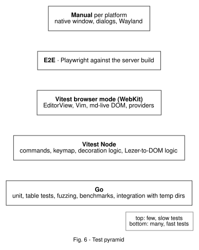

# 04 – Testing

Updated 2026-11-08

## What's realistic with Wails

- **Go services:** normal `go test`. Build the service struct directly and inject dependencies ([Wails testing guide](https://wails.io/guides/testing/)).
- **E2E:** the official way is Playwright against a **server build** (`go run -tags server,production .`). The app runs as an HTTP server with real Go services, and Playwright drives a normal browser ([E2E guide](https://wails.io/guides/e2e-testing/)). Not covered: native windows, OS menus, tray, native file dialogs, Wails message dialogs.
- **Native WebView automation** (WebDriver for WKWebView/WebKitGTK): no documented or proven way. Covered by a short manual checklist instead.
- **Vitest browser mode:** stable since Vitest 4 with a Playwright provider. Playwright's `webkit` engine is close to WKWebView/WebKitGTK, but not identical (confirm the setup in Spike S5).
- **CM6 and jsdom:** jsdom has no layout, no `ResizeObserver`, no coordinates. So `EditorState` logic runs in Node, anything with `EditorView` runs in browser mode.

## Test pyramid

Rule of thumb: cut logic so it can be tested in the lowest layer that works.

## Per layer

### Go (`go test ./...`)

| Module | Kind | What |
|---|---|---|
| `workspace` | table tests, **fuzzing** | `Resolve`: `..`, `%2e%2e`, absolute paths, symlinks pointing out, Unicode normalization (NFC/NFD on macOS). Atomic write: an abort leaves the original. Conflict on changed mtime. Registry: closing stops watcher, PTYs and LSP; unknown ID → error |
| `fsserve` | `httptest` | 200, 206 on `Range`, 304 on `If-None-Match`, 403/404 outside the root, HEAD |
| `watch` | integration with `t.TempDir()` | create/change/rename → event within timeout. Own writes filtered. Atomic save (temp + rename) gives exactly one `changed` |
| `index` | table tests, golden rankings, benchmarks, fuzzing | "query → expected top hit" list. No panic on any input. K9/K10 as benchmarks |
| `config` | table tests | defaults; broken JSON → defaults + error |
| `lsp` | unit + fake server, optionally real `gopls` | framing with split and merged reads, restart after crash, shutdown on workspace close. Real `gopls` only if installed (`t.Skip` otherwise) |
| `pty` | integration with `/bin/sh` | `echo hi` arrives, resize changes `stty size`, exit code reported, 1 MB output arrives complete and in order, close kills the process group (no zombies) |
| `search` | table tests + benchmarks | literal/regex/case, binary files skipped, cancel via context, replace with conflict. Benchmark against `rg` (local only) |
| `app` | a few smoke tests | wiring only, no logic here |

- Watcher behavior differs per OS → CI on macOS **and** Linux.
- Race detector (`-race`) always on.

### Frontend in Node (Vitest)

- `core/commands`, `core/keymap`: registering, context resolution, conflicts.
- `core/viewers`: provider choice by `canOpen` priority.
- `mdlive`: the decoration function `(EditorState, ranges) → [{from, to, kind}]`. Cases: Markdown snippet + cursor position → expected hidden ranges, as explicit arrays.
- `mdpreview`: Lezer tree → HTML for fixtures (lists, tables, escaping `<script>`).
- `backend.ts` is replaced by a fake backend everywhere (in-memory file system).

### Frontend in the browser (Vitest + Playwright, `webkit`)

- **Editor + Vim:** mount a real `EditorView`, send keys with `userEvent`. `dd`, `ciw`, `:w` calls `file.save`, leader mappings, custom motion with an operator.
- **Vim core list** (M1): a table "keys + start text → expected text/cursor" for the list below. Every failure is a documented gap in codemirror-vim.

### Vim core list (Q20)

The basics that must feel exactly like nvim:

| Group | Keys |
|---|---|
| Moving | `h j k l`, `w b e`, `W B E`, `0 ^ $`, `gg G`, `{number}G`, `f t F T ; ,`, `%`, `Ctrl-d Ctrl-u`, `H M L`, `zz` |
| Search | `/ ?`, `n N`, `* #` |
| Insert | `i a I A o O`, `Esc`, `jk` (own mapping) |
| Edit | `x`, `r`, `dd yy cc`, `D C`, `p P`, `u Ctrl-r`, `.`, `J`, `>> <<`, `~` |
| Operators + motions | `d c y` with any motion above (`dw`, `c$`, `y}`, `dG` …), counts (`3dd`, `5j`) |
| Text objects | `iw aw`, `i" a"`, `i' a'`, `i( a(`, `i{ a{`, `i[ a[`, `it at`, `ip ap` |
| Visual | `v V Ctrl-v`, `o`, operators on the selection, `I A` in block mode |
| Registers | `"ay "ap`, `"+y "+p` (system clipboard), `"0p` |
| Macros | `qa … q`, `@a`, `@@` |
| Marks and jumps | `ma 'a`, `Ctrl-o Ctrl-i` |
| Ex | `:w :q :wq :e`, `:s` / `:%s` with flags, `:{number}` |
| Folds | `za zc zo zR zM` |

Not needed for v1: `:g`, `:normal`, `gv`, `Ctrl-a/Ctrl-x`, `gq`, spell checking.
- **Terminal:** mount the xterm provider with a fake stream. Bytes in → text in the buffer. Keys → bytes out. `Ctrl-\ Ctrl-n` switches to normal mode.
- **LSP client:** editor with a fake transport (recorded gopls answers). A diagnostic shows as a lint marker, the completion list opens.
- **md-live in the DOM:** markers hidden outside the cursor line, visible on it. Image widget loads. Table widget renders cells.
- **Providers:** `mount` → `focus` → commands → `dispose` cleans up DOM and listeners (no leaks).
- **Benchmarks** (K4) run here, but not as a hard CI limit.

### E2E (Playwright against the server build)

- Start with `go run -tags server,production . --workspace testdata/e2e-ws` (the flag is ours, so no native folder dialog is needed).
- Engine `webkit`, optionally `chromium` for comparison.
- Scenarios per milestone ([05](05-roadmap.md)), e.g.:
  - folder open → tree visible → `Ctrl+P` → query → Enter → file in editor
  - edit, `:w`, check the file on disk
  - change the file externally → buffer reloads or shows a conflict
  - open PDF → page 1 visible → search finds a hit
  - open terminal → `echo $PWD` shows the workspace root → truecolor output renders
  - open a Go file with an error → diagnostic appears (only if `gopls` is in CI)
  - project search → hits in quickfix → `:cn` jumps
- Whether streams work in the server build is unverified (they go through the asset server, so they should). Checked in M0. If not, terminal and LSP stay on browser tests with a fake stream plus the manual checklist.
- The server build uses the browser's network path, not the custom scheme. Scheme bugs (Range, caching) don't show up here → Spike S2 + manual checklist.

### Manual checklist (each milestone, macOS + Hyprland)

- App starts, window appears, no blank white window.
- Native folder dialog opens.
- Scrolling `big.md` and `200p.pdf` is smooth.
- Drag and drop a file to open it.
- Terminal: `htop`, `lazygit`, `nvim` work (colors, mouse, resize), copy/paste, Alt keys.
- Open and close a second window, then no orphaned shell/LSP processes (`ps`).
- HiDPI and fractional scaling on Hyprland look right.
- Target: ≤ 10 minutes. If it takes longer, automate something.

## CI (GitHub Actions)

| Job | Runs on | Does |
|---|---|---|
| go | macOS, Ubuntu | `go vet`, `go test -race ./...`, short fuzz runs (`-fuzztime=30s`) |
| frontend | Ubuntu | `bun install --frozen-lockfile`, typecheck, Vitest Node, Vitest browser (WebKit, from M1) |
| e2e | Ubuntu | server build + Playwright WebKit (from M1) |
| build | macOS, Ubuntu | `wails3 build`, check size (K12) (from M1) |

Unverified: whether Ubuntu runners have WebKitGTK 6.0 / GTK ≥ 4.10 for the native build. If not, build Linux in a container or only on my machine.

## When is a milestone "tested"?

- Every new Go function with branches has a test.
- Every new command has at least one test that runs it through the registry.
- At least one E2E scenario covers the new slice.
- Affected budgets are measured and logged in `docs/perf-log.md`.
- Manual checklist done on both platforms.

Sources: [Wails testing](https://wails.io/guides/testing/) · [Wails E2E](https://wails.io/guides/e2e-testing/) · [Vitest browser mode](https://vitest.dev/guide/browser/why)
