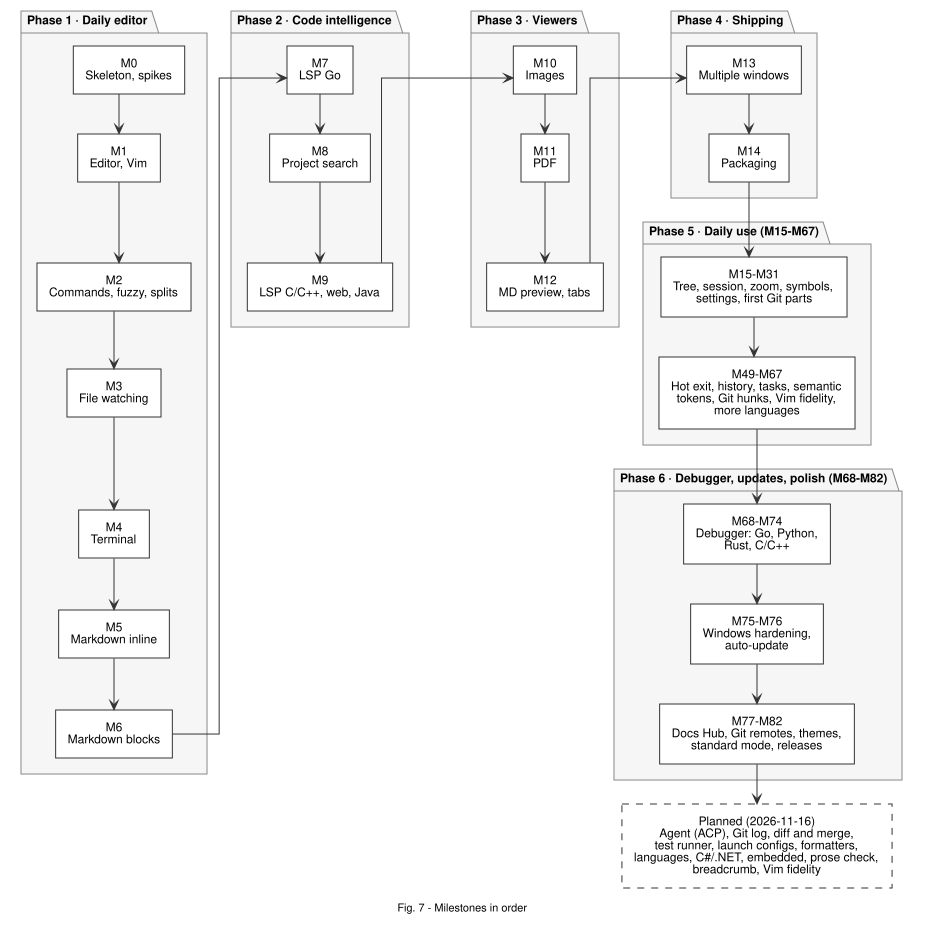

# 05 – Roadmap

Updated 2026-11-17 · Each milestone was a vertical slice: afterwards the app starts and can do a bit more than before. What was built in detail and how it was tested is in the commit and PR history; this page is the overview.

- **[Own]** = I write it myself: worth learning, well-scoped, testable.
- **[Glue]** = wire up a library, little logic of our own.
- Every milestone also has to meet [When is a milestone "tested"?](04-testing.md#when-is-a-milestone-tested).

**Order:** first an editor with terminal and Markdown live preview I can use every day (M1–M6), then LSP and project search (M7–M9), then images and PDF (M10–M12), then windows and packaging (M13–M14). Markdown comes before LSP on purpose (Q27). The terminal comes early (M4) because it's a core requirement and sets up the stream pattern for LSP. File watching comes before it (M3), otherwise things done in the terminal (`git checkout`, codegen) never reach the editor.

## Phases

| Phase | Milestones | Goal | State |
|---|---|---|---|
| Phase 1 · Daily editor | M0–M6 | A folder, a tree, an editor with Vim, a terminal and Markdown that renders while you type. | done |
| Phase 2 · Code intelligence | M7–M9 | Language servers and project search. | done |
| Phase 3 · Viewers | M10–M12 | Images, PDFs and a separate Markdown preview. | done |
| Phase 4 · Shipping | M13–M14 | Several windows and packaging. | done |
| Phase 5 · Daily use | M15–M67 | Everything that came up while using it: sessions, Git, tasks, history, more languages, Vim fidelity. | done |
| Phase 6 · Debugger and polish | M68–M82 | Debugger for four languages, auto-update, Docs Hub, themes, releases. | done |
| Planned | 15 plans | Agent, Git log, test runner, embedded, more languages, and more | planned |

## Done

M0–M5 have no date recorded.

### Phase 1 · Daily editor

| | What | What you get | Done |
|:--|:--|:--|:--|
| M0 | Skeleton, measuring, spikes | Empty Wails v3 window, build, measuring harness and the first spikes. | done |
| M1 | Open a folder, tree, edit and save a file | Open a folder; file tree, CodeMirror editor with Vim and highlighting, safe saving. | done |
| M2 | Commands, keymap, fuzzy finder, splits | Command registry with palette, configurable keymap, fuzzy finder, splits and buffer list. | done |
| M3 | File watching | The folder is watched; external changes (e.g. `git checkout`) show up in tree and buffers. | done |
| M4 | Terminal | A real PTY terminal (xterm.js) as bottom panel or as a pane. | done |
| M5 | Markdown live preview, inline | Markdown renders while you type: headings, emphasis, links, code, inline images. | done |
| M6 | Markdown live preview, blocks | Blocks too: code blocks, quotes, lists, task lists, tables, rules. | 2026-11-09 |

### Phase 2 · Code intelligence

| | What | What you get | Done |
|:--|:--|:--|:--|
| M7 | LSP for Go | gopls: diagnostics, completion, hover, go to definition, references, rename. | 2026-11-09 |
| M8 | Project search and quickfix | Parallel project search (literal or regex) with a quickfix list and replace. | 2026-11-09 |
| M9 | LSP for C/C++, web, Java | clangd, TypeScript/JavaScript, HTML/CSS/JSON and Java servers through one server table. | 2026-11-09 |

### Phase 3 · Viewers

| | What | What you get | Done |
|:--|:--|:--|:--|
| M10 | Image viewer | Image viewer with zoom and pan. | 2026-11-09 |
| M11 | PDF viewer | PDF viewer with page keys and full-text search. | 2026-11-09 |
| M12 | Separate Markdown preview and optional tabs | Separate Markdown preview as a second pane on the same buffer; optional tab bar. | 2026-11-09 |

### Phase 4 · Shipping

| | What | What you get | Done |
|:--|:--|:--|:--|
| M13 | Multiple windows and switching folders | Several windows and switching folders; closing a workspace stops its processes. | 2026-11-09 |
| M14 | Packaging and hardening | macOS app bundle, Linux desktop file and PKGBUILD, install guide. | 2026-11-09 |

### Phase 5 · Daily use

| | What | What you get | Done |
|:--|:--|:--|:--|
| M15 | File operations in the tree | Create, rename, trash and reveal files from the tree. | 2026-11-10 |
| M16 | Session per folder | The session (tabs, splits, cursors) is saved and restored per folder. | 2026-11-10 |
| M17 | Zoom | Zoom the whole window with `Cmd +`, `-`, `0`. | 2026-11-10 |
| M18 | Reopen closed tabs, back and forward across files | Reopen closed tabs; back and forward across files. | 2026-11-10 |
| M19 | Git in the gutter, branch in the status line (L2, first part) | Git branch in the status line, change marks in the gutter. | 2026-11-10 |
| M20 | Symbols | Symbols of the file and the workspace in the picker. | 2026-11-10 |
| M21 | Diagnostics as a list and in the status line | All diagnostics as a list; counts in the status line. | 2026-11-10 |
| M22 | Cleanup on save, line wrap | `:w` trims trailing spaces and ends with one newline; line wrap. | 2026-11-10 |
| M23 | Cmd+Q asks first | `Cmd+Q` asks first when any window has unsaved buffers. | 2026-11-10 |
| M24 | Comments, closing brackets, surround | Comment toggle (`gcc`), closing brackets, surround. | 2026-11-10 |
| M25 | LSP keys | LSP keys: hover (`K`), rename, code actions. | 2026-11-10 |
| M26 | settings.json | `settings.json` for font, size, tab width, wrap, format on save and more. | 2026-11-10 |
| M27 | Bundled symbols font | Bundled Symbols Nerd Font, so icons work without an installed Nerd Font. | 2026-11-10 |
| M28 | Welcome page with keys | The start page of a window without a folder lists recent folders and the first keys to know. | 2026-11-10 |
| M29 | Git status in the tree (L2, second part) | Git status colours in the file tree. | 2026-11-10 |
| M30 | Diff against HEAD (L2, last part) | Diff against HEAD in the editor. | 2026-11-10 |
| M31 | Filter the tree | Filter the tree by typing. | 2026-11-10 |
| M49 | Hot exit | Unsaved buffers are kept in swap files and come back after a crash or quit. | 2026-11-10 |
| M50 | Local history | Every save keeps the text it replaced; restore from a picker. | 2026-11-10 |
| M51 | Big files and repositories measured | Big files and big repositories measured; very long lines open as plain text. | 2026-11-10 |
| M52 | Tasks | Tasks from `settings.json` run in a terminal split, errors go to quickfix. | 2026-11-10 |
| M53 | Shell integration | `ayaz file[:line[:col]]` opens a file in the running app; OSC 7 tracks the shell's folder. | 2026-11-10 |
| M54 | Semantic tokens | Semantic token colours from the language server. | 2026-11-10 |
| M55 | Structural text objects | Structural text objects: function, class, argument (`af`, `ac`, `aa`). | 2026-11-10 |
| M56 | Document highlight | Other occurrences of the symbol under the cursor are highlighted. | 2026-11-10 |
| M57 | Sticky scroll | Sticky scroll: the enclosing functions and classes stay at the top. | 2026-11-10 |
| M58 | Call hierarchy | Call hierarchy (callers and callees) into the quickfix list. | 2026-11-10 |
| M59 | Completion: extra edits, snippets | Completion applies extra edits and snippets. | 2026-11-10 |
| M60 | Inline blame | Inline git blame for the cursor line. | 2026-11-10 |
| M61 | Stage hunks | Stage and unstage single hunks. | 2026-11-10 |
| M62 | Merge conflicts | Merge conflict blocks are found and coloured in every editor. | 2026-11-10 |
| M63 | Vim fidelity | About 90 daily nvim commands covered by browser tests; Vim gaps closed. | 2026-11-10 |
| M64 | Release readiness | CI runs browser and E2E tests on macOS and Linux with a real gopls. | 2026-11-10 |
| M65 | UX pass | UX pass from an unattended session: picker previews and polish. | 2026-11-11 |
| M66 | More languages, Typst and LaTeX | Highlighting and servers for Python, Rust, YAML, TOML, shell, SQL, XML, PHP, Lua, Typst, LaTeX. | 2026-11-11 |
| M67 | Small daily things | Small daily things, e.g. pasting an image into Markdown saves it next to the file. | 2026-11-11 |

### Phase 6 · Debugger and polish

| | What | What you get | Done |
|:--|:--|:--|:--|
| M68 | Debugger: program stderr | The debugged program's stderr shows up in the output buffer. | 2026-11-11 |
| M69 | Debugger: adapter table and stdio mode | Debug adapter table instead of Go-only launching. | 2026-11-12 |
| M70 | Debugger: conditional breakpoints, logpoints and hit counts | Conditional breakpoints, logpoints and hit counts. | 2026-11-12 |
| M71 | Debugger: watch expressions | Watch expressions. | 2026-11-12 |
| M72 | Debugger: program stdin and runInTerminal | Program stdin through `runInTerminal`. | 2026-11-12 |
| M73 | Debugger: Python with debugpy | Python debugging with debugpy. | 2026-11-12 |
| M74 | Debugger: Rust, C, C++ with lldb-dap | Rust, C and C++ debugging with lldb-dap. | 2026-11-12 |
| M75 | Git staging tab, platform-specific install hints and Windows hardening | Git staging tab, install hints per platform, Windows hardening. | 2026-11-12 |
| M76 | Platform-independent in-app auto-update and local release workflow | In-app auto-update and a local release workflow. | 2026-11-12 |
| M77 | Docs Hub | The in-app docs as a page with categories, reading mode, light mode and a table of contents. | 2026-11-13 |
| M78 | Git remotes and cloning | Fetch, pull, push and rebase, a clone dialog, remote actions as icons in the sidebar. | 2026-11-13 |
| M79 | Themes and start page | Eleven built-in themes, a ligatures setting, a start page with recent folders as a star chart. | 2026-11-13 |
| M80 | Standard mode and HTML preview | Non-Vim standard mode (`Cmd/Ctrl+Shift+M`) and an internal browser preview for HTML. | 2026-11-14 |
| M81 | Release automation | release-please writes the release PR and `CHANGELOG.md`; multi-platform packaging. | 2026-11-14 |
| M82 | Small daily things, part 2 | GitHub links, search resume and TODO list, history restore, task placeholders, terminal file links. | 2026-11-16 |

## Planned

Plans written on 2026-11-16, each split into tasks with one PR per task. The plan documents are in `docs/plans/` of the main folder and are not committed yet.

| Group | Plan | What it is about |
|:--|:--|:--|
| Git and review | Git log | History of the project, a file and a line selection; open commits and compare a file at an old commit, all by keyboard. |
| Git and review | Diff and merge view | Side-by-side diff that marks changes and scrolls in step, comparison against the index, help with merge conflicts. |
| Run and debug | Test runner | Run the test under the cursor, the file or all tests with one key; pass or fail in the gutter, failures in quickfix; Go first. |
| Run and debug | Launch configurations | A VS Code compatible `launch.json` for debug runs: arguments, environment, folder, build step, attach. |
| Run and debug | VS Code tasks | Read `.vscode/tasks.json` and offer its tasks in `<Space>rr`. |
| Run and debug | Embedded debugger | Debug a Pico with OpenOCD and GDB over CMSIS-DAP: flash, breakpoints, steps, variables, CPU registers. |
| Languages | More languages | Fallback highlighting from `@codemirror/legacy-modes` and your own language servers in `settings.json`. |
| Languages | Formatters | External formatters (shfmt, ruff, stylua, prettier) for `:w` and manual formatting where the language server does not format. |
| Languages | C#/.NET | C#, Avalonia and ASP.NET: Roslyn language server, dotnet tasks, debugging. |
| Languages | Embedded basics | Build and flash Pico-SDK (CMake) projects, colour assembler and linker files, clangd with the cross compiler; ESP32 later. |
| Editor | Agent (ACP) | A coding agent (Claude, Codex, Gemini, OpenCode) runs as a subprocess and talks to Ayaz over the Agent Client Protocol: thread, prompt, edits reviewed before they are saved. Replaces E11. |
| Editor | Breadcrumb | The file path and the enclosing functions above the editor; a click jumps to one. |
| Editor | Prose check | Spelling and grammar in Markdown, Typst and text files with harper-ls, suggestions on hover. |
| Editor | Vim fidelity | Vim patterns instead of JavaScript patterns in `:s` and `:g`, `:retab`, and the text-object details that differ from Vim. |
| Editor | Quality of life | Eight small everyday features, one PR each; some are done (M82). |

## Open

Small UI items from the old "Extended" list that are not done.

| | What | Notes |
|:--|:--|:--|
| E4 Status line | Encoding and powerline shapes like lualine bubbles | Git branch and diagnostics came with M19 and M21. |
| E5 Cmdline and messages | Messages as a floating box, notifications that fade out | The `:` line is a floating box (`Cmdline.tsx`); the rest is not checked. |
| E6 Scrolling and motion | Smooth scrolling, animated indent scope | Check that 120 fps holds. |
| E8 Window | Window title with folder and file | The macOS title bar is hidden with native traffic lights; the title is not checked. |
| E9 Theme | Follow the desktop theme (caelestia) | More themes are done (M79). |
| E10 Details | Scrollbar style, cursor line edge, spacing between tree and editor, hover states | Small fixes from daily use. |
| E11 Agent | Inline agent at the cursor like Zed | Removed in 2026-11 (canned answers only); the Agent (ACP) plan replaces it. |

---

## What I write myself, and why

| Module | Why it's worth writing |
|---|---|
| `workspace` (jail, atomic write, registry) | security, data loss, learn fuzzing |
| Fuzzy matcher + index | algorithm, benchmarks |
| Command registry + keymap | the core of the controls, small and pure |
| Splits/buffer model + bottom panel | tree data structure, easy to test |
| PTY output batching | concurrency, latency vs. throughput |
| LSP framing + process management | protocol, processes, concurrency |
| Project search + quickfix | worker pool, streaming, cancellation |
| `mdlive` | CM6 decorations, pure functions |
| Lezer → DOM (separate preview) | tree traversal, escaping |
| Virtualized file tree | DOM performance |
| Custom Vim motions | well-scoped via `defineMotion` |

Everything else (Wails setup, CM6/Vim/language config, xterm.js, LSP clients, pdf.js, image viewer, fswatcher adapter, `fsserve` wrapper, packaging) is glue.

