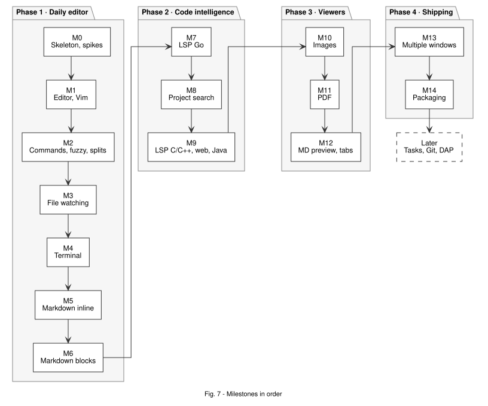

# 05 – Roadmap

Updated 2026-11-08 · Each milestone is a vertical slice: afterwards the app starts and can do a bit more than before.

- **[Own]** = I write it myself: worth learning, well-scoped, testable.
- **[Glue]** = wire up a library, little logic of our own.
- Every milestone also has to meet [When is a milestone "tested"?](04-testing.md#when-is-a-milestone-tested).

**Order:** first an editor with terminal and Markdown live preview I can use every day (M1–M6), then LSP and project search (M7–M9), then images and PDF (M10–M12), then windows and packaging (M13–M14). Markdown comes before LSP on purpose (Q27). The terminal comes early (M4) because it's a core requirement and sets up the stream pattern for LSP. File watching comes before it (M3), otherwise things done in the terminal (`git checkout`, codegen) never reach the editor.

---

## M0 – Skeleton, measuring, spikes

**Goal:** an empty Wails v3 window with a Kanagawa background. Build and measurements work on both platforms.

**Order (riskiest first):** S1 → ping + S4 → Kanagawa → S6/S7 → harness → CI → S5. If S1 fails on Hyprland, stop and revisit ADR-0001 before anything else.

- [Glue] `wails3 init` (React TS template), pin the version, switch the Taskfile to Bun.
- [Glue] Folder layout from [02](02-architecture.md#folder-layout-planned), `backend.ts` with a ping binding.
- [Glue] Kanagawa tokens as CSS variables.
- [Glue] CI skeleton: only the `go` job and Vitest Node from [04](04-testing.md#ci-github-actions). Browser, E2E and build jobs join in M1.
- [Own] Measuring harness: `AYAZ_EXIT_ON_READY`, `app:ready` event, RAM script for the process tree (`ps`, macOS + Linux).
- Spikes are built **into the skeleton** where possible (no separate apps). Throwaway parts live in `spikes/`, results go into `01-research.md`:
  - **S1:** Wails v3 on Hyprland/Intel UHD: starts, GPU path on, scroll test with 10,000 DOM rows (inside the skeleton).
  - **S4:** binding round-trip latency (empty call, 50 results), measured on the ping binding.
  - **S6 + S7 (one spike):** xterm.js + creack/pty + stream: K13/K14 with DOM and WebGL renderers on both platforms, batching parameters. Then the same stream path as an echo for LSP-like messages (K16), also in the server build.
  - **S5:** Vitest browser mode with WebKit under Bun. Time box 1 h; if it fails, run Vitest under Node and note it in ADR-0008.
- Moved: **S2** (Range headers through `/fs/`) to the start of M6, **S3** (pdf.js, 200 pages) to the start of M11. They're only needed there.

Done when:
- The app starts on macOS and Hyprland, K1/K2/K12 measured for the first time in `docs/perf-log.md`.
- One Go test and one Vitest Node test run in CI. One Vitest browser test and one Playwright E2E test run locally.
- Results of S1, S4, S5, S6/S7 written down, affected ADRs (0001, 0007, 0008, 0009, 0013) set to accepted or rejected. ADR-0004 and 0005 stay proposed until S2/S3.

## M1 – Open a folder, tree, edit and save a file

- [Own] `workspace`: registry, `Resolve` (jail), `List`, `ReadText`, atomic `WriteText` with mtime conflict check.
- [Glue] Open a folder via CLI argument and native dialog.
- [Own] File tree, virtualized, lazy per folder.
- [Glue] CM6 + Vim + Kanagawa theme, editor basics (line numbers, relative numbers, bracket matching, indentation, in-file search via `@codemirror/search`).
- [Glue] `lang/registry.ts` with highlighting for all target languages, loaded lazily.
- [Own] Buffer store (dirty, mtime).
- [Glue] `:w`, `:e`, `:q` via `Vim.defineEx`.
- [Own] **Vim core list** as tests ([04](04-testing.md#vim-core-list-q20)): shows what codemirror-vim can't do.

Tests: fuzzing `Resolve`, atomic write and conflict, Vim core list in the browser, E2E open/edit/save.

Done when: a real file can be edited with highlighting. An external change leads to an error instead of overwriting. Vim gaps are written down and judged.

## M2 – Commands, keymap, fuzzy finder, splits

- [Own] `core/commands` + `core/keymap` (ADR-0010), every key configurable (Q22). Move the M1 ex commands onto commands.
- [Own] `index` + fuzzy matcher (ADR-0007), file rules from Q26 incl. the setting to show ignored files.
- [Glue] Picker (`<Space>ff`, `Cmd+P` / `Ctrl+Shift+P`), recent files (`<Space>fo`), buffer list (`<Space>fb`), command palette.
- [Glue] Default keymap from my nvim config ([02](02-architecture.md#default-keymap-from-my-nvim-config)).
- [Own] Splits (`:split`, `:vsplit`, `Ctrl-h/j/k/l` and `Ctrl-w h/j/k/l`), buffers independent of panes.
- [Glue] Status line with Vim mode.

Tests: golden rankings, K9/K10 benchmarks, keymap contexts and user overrides, E2E open and split a file by keyboard only.

Done when: every action works by keyboard and shows up in the palette. K9/K10 within budget.

## M3 – File watching

- [Glue] `watch` with fswatcher v2 behind an interface (ADR-0006), self-write filter, overflow → rescan.
- [Own] Frontend reaction: update the tree, reload clean buffers (keep the cursor), dirty buffers → conflict notice.
- [Glue] Incremental index updates.

Tests: Go integration on macOS and Linux, E2E external change.

Done when: `git checkout` in an external terminal shows up correctly, no data loss. K11 within budget.

## M4 – Terminal

- [Glue] `pty` with creack/pty. [Own] Output batching (ADR-0013).
- [Glue] Terminal provider with xterm.js 6, addons fit/web-links/search/unicode, Kanagawa ANSI colors.
- [Own] Bottom panel (`<Space>t`, `Cmd+J` / `Ctrl+Shift+J`) and terminal as a split (`<Space>tc`, `:terminal`) (Q23). `<Space>gg` opens lazygit.
- [Own] Terminal modes (insert/normal, `Ctrl-\ Ctrl-n`) and keymap context `terminal`.
- [Glue] Renderer choice based on S6.

Tests: Go integration with `/bin/sh`, browser tests with a fake stream, E2E `echo $PWD`, manually htop/lazygit/nvim.

Done when: everything that runs in a native terminal runs here, in the panel and in a split. K13/K14 within budget. Closing leaves no processes behind.

## M5 – Markdown live preview, inline

- [Own] `mdlive` part 1: headings, emphasis, inline code, links (markers hidden outside the cursor line), `atomicRanges`.
- [Glue] Links: `gx` → system browser, `gf` on relative `.md` links.
- [Own] Reading view (added 2026-11-09): `<Space>mr` shows Markdown with no raw line at all, not even the cursor line; read-only, status line `READ`.
- [Own] Resizable panes (added 2026-11-09): drag split borders and the panel's top edge; sizes kept per folder. Panel maximize toggle. Vim keys `<C-w>+/-/</>/=`. Reason: the panel at 35 % is too small for btop (needs 24 rows).

Tests: ≥ 30 Node fixtures for the decoration function, browser test of marker visibility with `j/k`. Node tests for layout sizes, E2E drag and `<C-w>=`.

Done when: notes read as if rendered, and Vim motions move cleanly over hidden markers. btop runs in the panel after enlarging it.

## M6 – Markdown live preview, blocks

- First: **Spike S2** (`/fs/` middleware with `http.ServeContent`: do Range headers come through the scheme on macOS and WebKitGTK?). Settles ADR-0005.
- [Own] `mdlive` part 2 (StateField): tables, inline images, code blocks with highlighting (language packages from M1), quotes, task lists.
  - Done 2026-11-09: code blocks, quotes and bullets, task list checkboxes, tables (raw while the cursor is in them), horizontal rules. `fsserve` (Go side, tests incl. Range and fuzz), inline images (relative paths only, via `/fs/`). **Still open:** S2 on WKWebView/WebKitGTK, K3–K5 on real hardware.
- [Own] `fsserve` with jail and workspace ID (ADR-0005).

Tests: `fsserve` with `httptest`, widget browser tests, K3–K5 with `big.md`.

Done when: `big.md` opens and scrolls within budget on both platforms.

## M7 – LSP for Go

- [Own] `internal/lsp`: process management, framing, restart (ADR-0009).
- [Glue] Transport adapter on streams, `@codemirror/lsp-client` for Go with `gopls`.
  - Done 2026-11-09: `internal/lsp` + `lsp` stream, transport, client per (workspace, language) with reconnect/backoff, diagnostics, completion, hover, `gd`, `gr`, rename (F2), format on save, jumps across files inside the workspace (own `Workspace`, several panes per file), `lsp:status` hint when the server is missing, E2E with real gopls, read-only jumps into the Go stdlib and module cache (Go reads only below `go env GOROOT GOMODCACHE`), K16 (~1.4 ms p95 at 200 KB, perf-log). **Still open:** manual check in the real app.
- [Glue] Diagnostics, completion, hover, go to definition (`gd`), references (`gr`), rename, format on save (per language, on for Go, Q25).
- [Glue] Status line hint when a server is missing.

Tests: framing unit tests, fake server, browser tests with a fake transport, K16.

Done when: writing Go feels like nvim with gopls.

## M8 – Project search and quickfix

- [Own] `search` in Go with streaming and cancellation (ADR-0016).
- [Own] `core/quickfix` with `:cn`, `:cp`, `:copen`. LSP references from M7 move in here.
- [Glue] Search UI (`<Space>fw`), replace with preview.
  - Done 2026-11-09: `internal/search` (worker pool, smart case, literal or RE2, skips binary and > 2 MB, stops at 10,000 hits), `search` stream (batches every 30 ms, closing it cancels), picker with `<C-q>` to quickfix, `:cn`/`:cp`/`]q`/`[q`/`:copen`, `:Replace text` with a preview picker (clean buffers are saved, dirty ones stay unsaved, moved matches are skipped), `gr` fills quickfix. After a regex search `:Replace` expands `$1`…`$9`, `$0` and `$$` (Go sends each hit's groups, so RE2 decides them); after a literal search the text stays literal. Shortcut: `:copen` is a picker, not a window.

Tests: Go table tests and K15 benchmark, E2E search and jump.

Done when: search and replace across the project works by keyboard. K15 within budget.

## M9 – LSP for C/C++, web, Java

One sub-slice each, in this order:
- [Glue] C/C++ with `clangd` (hint about `compile_commands.json`).
- [Glue] Web: `typescript-language-server`, `vscode-langservers-extracted` (HTML/CSS/JSON).
- [Glue] Java with `jdtls` (measure JVM start time and RAM).

  - Done 2026-11-09: one server table (`serverFor` in `editor/lsp.ts` → command in `app/lsp.go`), one server per (workspace, server), so `.c`/`.cpp` share clangd and `.ts`/`.js` share one TypeScript server. clangd hint when no `compile_commands.json`/`compile_flags.txt` is in the root or `build/`, read-only jumps into system headers, E2E with real clangd. jdtls gets a data folder per project under the user cache. Format on save stays Go only (Q25). **Still open (servers not installed here):** manual tests with `typescript-language-server`, `vscode-langservers-extracted` and `jdtls`, JVM start time and RAM; jumps into TypeScript's `lib.d.ts` and jdtls' `jdt://` class files aren't shown.

Tests: one fake-transport test per language for the mapping, manual tests with real servers.

Done when: all four language groups have diagnostics, completion and navigation.

## M10 – Image viewer

- [Glue] `viewers/image`: fit/100 %, zoom (`+/-/0`), pan (`h/j/k/l`), animated GIFs, SVG only as ``.
- Tests: provider lifecycle, E2E open and zoom.
- Done when: all five formats work, fully keyboard-controlled.
- Done 2026-11-09: `core/viewers.ts` (small provider registry, ADR-0011) and `viewers/image.ts`: fit, `+`/`=`/`-` zoom around the center, `0` fit, `1` 100 %, `h/j/k/l` pan, zoom and size in the status line, reload on change on disk. A split of an image pane shows the image too; opening a text file turns the pane back into an editor. `/fs/` now sends `Content-Security-Policy: sandbox …` so an SVG or HTML opened by URL can't run scripts. Shortcut: the editor and terminal aren't providers yet, `Editors` handles them directly.

## M11 – PDF viewer

- First: **Spike S3** (pdf.js `PDFViewer` with a 200-page PDF in both WebViews). Settles ADR-0004.
- [Glue] `viewers/pdf` with `PDFViewer`, `PDFFindController`, dynamic import (ADR-0004).
- [Own] Vim-like keymap (`j/k`, `gg/G`, `Ctrl-d/u`, `/`, `n/N`, zoom), page indicator.
- Tests: E2E open and search, K6–K8.
- Done when: a 200-page PDF is within budget, search by keyboard.
- Done 2026-11-09: `viewers/pdf.ts` on `PDFViewer` + `PDFFindController` (pdfjs-dist 6.4.299 pinned, loaded on the first PDF, worker as its own asset), page width by default, `j/k`, `<C-d>/<C-u>`, `gg/G`, `J/K` pages, `+/-/0/1` zoom, `/` `n` `N` search with the match count and page in the status line, links only through the system browser, no PDF scripting, no XFA, a PDF changed on disk reloads on the same page and zoom. `scripts/gen-bigpdf.mjs` makes the 200-page test file. S3 in headless WebKit only: K6 95 ms, K7 254 ms (perf-log). K8 in the app (perf-log): +448 MB with pdf.js defaults, +223 MB with `maxCanvasPixels` at pdf.js' phone value (now on); pages render in a worker (S8) and the sharp detail canvas follows when scrolling stops, so scrolling while pages render runs at p50 8 ms, p95 10 ms, max 17–19 ms per frame (perf-log). **Still open:** S3 in WKWebView and WebKitGTK, Range requests through the Wails scheme in the native app (S2), frame times on Hyprland, hand check with a real paper (fonts, images) and trackpad.

## M12 – Separate Markdown preview and optional tabs

- [Own] `viewers/mdpreview`: Lezer tree → DOM, debounced updates from the buffer store.
- [Glue] Command `markdown.togglePreview` (opens in a split).
- [Own] Optional tab bar per pane (setting), `gt/gT`.
- Tests: Node fixtures Lezer → HTML incl. escaping, browser test for updates while typing.
- Done when: the preview matches the live preview, no HTML from the document runs, tabs toggle without restart.
- Done 2026-11-09, differently than planned: the preview (`<Space>mp`) is a second pane on the same buffer in the reading view, not a second renderer from the Lezer tree. It matches the live preview because it is the same code, follows typing through the existing pane sync, and raw HTML stays text (cells and widgets use `textContent`). `<Space>mp` again closes it. Tab bar per pane (palette "Toggle tab bar", kept in `localStorage`), `gt`/`gT`, click, `<Space>bd` drops a tab (the buffer stays loaded), `[+]` on tabs with unsaved changes. Source and preview keep the same line at the top, both ways; the active pane leads, so the scroll doesn't echo.

## M13 – Multiple windows and switching folders

- [Glue] New window (`Cmd+Shift+N` / `Ctrl+Shift+N`), switch folder in a window (recent list + dialog) (ADR-0014).
- [Own] Workspace tear-down: buffers, watcher, index, LSP, PTYs. Ask when buffers are unsaved.
- Tests: registry tests (no orphaned processes), E2E two workspaces at once (if the server build allows it).
- Done when: two projects run side by side, switching folders needs no restart, leak #6505 checked.
- Done 2026-11-09: `Close(ws)` stops the watcher, drops the indexes, hangs up the workspace's shells and servers and forgets the ID (Go test: nothing of the closed workspace keeps running, the other one does). Bindings take Wails' `ctx`, so a workspace belongs to its window: the close button asks the frontend first (`app:close-request`; unsaved buffers block it like `:qa`), a close that goes through tears the workspace down. `:qa` now closes the window, the app quits after the last one. New window (`Cmd+Shift+N` / `Ctrl+Shift+N`) starts on the welcome screen with recent folders; `<Space>fp` switches folder (recent list or dialog), refused while buffers are unsaved; the frontend also stops that workspace's LSP clients. E2E: two pages side by side, switch, `/fs/` of the old ID gives 404. **Still open:** #6505 on Hyprland (closed windows leaving WebKitWebProcess behind), native window checks by hand (close button with unsaved buffers, `Cmd+Q`).

## M14 – Packaging and hardening

- [Glue] Linux: binary + `.desktop`, then PKGBUILD (Q14). macOS: unsigned `.app`.
- Measure K1–K16 on both machines and close the gaps.
- Done when: install by following the guide takes ≤ 5 minutes, all budgets green or consciously adjusted.
- Done 2026-11-09 on macOS: install guide in the README, `task darwin:package` gives an ad-hoc signed `bin/ayaz.app`, `build/linux/ayaz.desktop` and `build/linux/arch/PKGBUILD` (`ayaz-git`, gtk4 + webkitgtk-6.0). macOS budgets measured (perf-log): K1 398 ms, K2 111 MB, K12 13 MB, K6/K7/K15/K16 green. **Still open:** the PKGBUILD and all K numbers on Hyprland, the 5-minute install check by hand, a LICENSE (the PKGBUILD says unknown).

## M15 – File operations in the tree

- [Own] `workspace`: create, rename, trash; symlinks are renamed or trashed as links, never their target, the root never.
- [Glue] Tree keys like nvim-tree: `a` new (`/` at the end makes a folder), `r` rename/move, `d` trash, `y`/`Y` copy path, `s` reveal in Finder.
- Done 2026-11-10: `Create`/`Rename`/`Trash`/`Reveal` in `WorkspaceService`, Go tests for the jail. Trash moves into `~/.Trash` on macOS (no "Put Back") and uses `gio trash` on Linux. Name input and confirmation use the picker. Open buffers follow a rename (tabs, recent files) or close on trash; unsaved buffers block both. All of it also works from the palette on the active file, plus "Show current file in tree". The tree cursor now stays on its file when rows come and go (a save's temp file used to move it). E2E `tree.spec.ts`. **Still open:** the trash itself by hand in the app (e2e would fill the real trash), `gio trash` on Hyprland.

## M16 – Session per folder

- [Own] `shell/session.ts`: splits, the file and tabs per pane, the active pane and the cursor of the last 200 files, per folder in `localStorage`.
- Done 2026-11-10: saved at most every 500 ms (a throttle, not a debounce: a build writing files would push a debounce back forever), and at once on `:qa`, the close button and switching folders. Opening the folder restores it; terminals come back as empty editors, a preview as a normal editor, files that are gone are skipped. Without files in the session it starts in the tree as before. A broken entry starts fresh (Node tests), E2E `session.spec.ts` reloads the page. **Still open:** `Cmd+Q` quits without asking the frontend, so up to 500 ms of changes can be lost.

## M17 – Zoom

- Done 2026-11-10: `Cmd +`/`Cmd =`, `Cmd -`, `Cmd 0` (Linux `Ctrl`) zoom the whole page through Wails' `Window.SetZoom`, 50–200 % in 10 % steps, kept in `localStorage` for every window and set again at start. The status line shows the level. **Still open:** check in the app that xterm, the PDF canvases and dragging split borders stay right when zoomed; Hyprland.

## M18 – Reopen closed tabs, back and forward across files

- Done 2026-11-10: `Cmd+Shift+T` (Linux `Ctrl+Shift+T`) reopens the tab closed last, also the tabs of a closed pane (up to 50). Back/forward per pane across files with the cursor, like a browser: `Cmd+[`/`Cmd+]` and `Ctrl -`/`Ctrl Shift -` on macOS (brackets need Alt on German layouts), `Alt+←`/`Alt+→` on Linux. Every file switch counts (tree, picker, `gd`, quickfix, tabs), a rename does not. Vim's `<C-o>`/`<C-i>` inside a file stay. Node test for the stacks, E2E `nav.spec.ts`.

## Later

| | What | Plugs into |
|---|---|---|
| L1 Tasks/build | run commands by key (`go test`, `make`, `pio run`), output in the terminal, errors in quickfix | `pty` + `quickfix` |
| L2 Git | changes in the gutter, status in the tree, diff view | `git` process, CM6 gutter |
| L3 Debugger | DAP, breakpoints, variables (Delve first) | same pattern as LSP |
| L4 Shell integration | `EDITOR=ayaz open` from the terminal (e.g. `sf` in mysh opens a buffer), OSC 7 for the current directory (mysh extension) | `pty` + single instance/CLI |

## Extended – UI polish

The M1 UI is usable but not finished (user feedback 2026-11-08: "much better, still needs work"). Collected here, done when it fits or as its own milestone after M14. Reference: the user's nvim setup (`~/.config/nvim`: snacks, lualine, noice, nvim-web-devicons).

| | What | Notes |
|---|---|---|
| E1 Fonts | font family, size and ligatures as settings | today hard-coded FiraCode Nerd Font, 13 px |
| E2 Icons | bundle "Symbols Nerd Font" as a fallback, more file types and special names | without a Nerd Font installed, icons show as boxes |
| E3 Tree | dim hidden/ignored files, git status colors (L2), indent lines in the tree, filter by typing | like the snacks explorer |
| E4 Status line | git branch, diagnostics, LSP status, encoding, powerline shapes like lualine bubbles | segments come with M7/L2 |
| E5 Cmdline and messages | `:` line and messages as a floating box like noice, notifications that fade out | today codemirror-vim's bottom panel |
| E6 Scrolling and motion | smooth scrolling (like snacks.scroll), animated indent scope | check that 120 fps holds (S1) |
| E7 Welcome screen | dashboard with recent folders and keys, like the snacks dashboard | today one button |
| E8 Window | inset title bar on macOS, window title with folder and file | |
| E9 Theme | follow the desktop theme like the nvim colorscheme (caelestia), more themes than Kanagawa | tokens are already CSS variables |
| E10 Details | scrollbar style, cursor line edge, spacing between tree and editor, hover states | small fixes from daily use |

---

## What I write myself, and why

| Module | Why it's worth writing |
|---|---|
| `workspace` (jail, atomic write, registry) | security, data loss, learn fuzzing |
| Fuzzy matcher + index | algorithm, benchmarks |
| Command registry + keymap | the core of the controls, small and pure |
| Splits/buffer model + bottom panel | tree data structure, easy to test |
| PTY output batching | concurrency, latency vs. throughput |
| LSP framing + process management | protocol, processes, concurrency |
| Project search + quickfix | worker pool, streaming, cancellation |
| `mdlive` | CM6 decorations, pure functions |
| Lezer → DOM (separate preview) | tree traversal, escaping |
| Virtualized file tree | DOM performance |
| Custom Vim motions | well-scoped via `defineMotion` |

Everything else (Wails setup, CM6/Vim/language config, xterm.js, LSP clients, pdf.js, image viewer, fswatcher adapter, `fsserve` wrapper, packaging) is glue.
